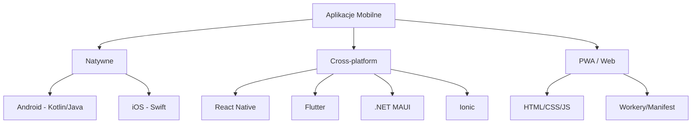

# Materiały z "Aplikacji mobilnych dla systemu Android"

Repozytorium zawiera materiały edukacyjne, przykładowe projekty oraz zasoby dotyczące programowania aplikacji mobilnych, ze szczególnym uwzględnieniem systemu Android oraz frameworków cross-platformowych takich jak React Native.

---

## 📋 Spis treści
1. [Opis zawartości folderów](#-opis-zawartości-folderów)
2. [Ekosystem technologii mobilnych](#-ekosystem-technologii-mobilnych)
3. [Przegląd technologii](#-przegląd-technologii)
4. [Zalecane książki i źródła](#-zalecane-książki-i-źródła)
5. [Inne zasoby](#-inne-zasoby)

---

## 📂 Opis zawartości folderów

Poniższa tabela przedstawia projekty znajdujące się w repozytorium wraz z ich krótkim opisem i wykorzystaną technologią.

| Folder | Opis | Technologia |
| :--- | :--- | :--- |
| `button-incrementer` | Prosta aplikacja zwiększająca licznik (useState) | React Native + Expo |
| `calculator-with-expo` | Implementacja prostego kalkulatora | React Native + Expo |
| `cleverly-main` | Projekt z kursu "Zostań programistą aplikacji mobilnych" | React Native |
| `imagerotation` | Przykład aplikacji do rotacji obrazków | React Native + Expo |
| `Java-simple-exercises` | Podstawowe ćwiczenia z języka Java | Java |
| `JavaScriptReminder` | Kompendium wiedzy o JavaScript w formie aplikacji | React Native |
| `JS-exercises` | Ćwiczenia z nowoczesnego JavaScriptu (ES6+) | JavaScript |
| `react-przypomnienie` | Podstawy Reacta na bazie tutoriala W3Schools | React |
| `rn_basic_calculator` | Kalkulator zbudowany bez użycia Expo | React Native CLI |
| `slides` | Materiały dydaktyczne (wykłady) | PDF / Dokumenty |
| `SQLite` | Aplikacja demonstracyjna z lokalną bazą danych | React Native + SQLite |

---

## 🛠 Ekosystem technologii mobilnych

Poniższy diagram przedstawia podział technologii mobilnych ze względu na podejście do tworzenia aplikacji:

---

## 🚀 Przegląd technologii

### A. Aplikacje Natywne
1. **Android** - [Oficjalna dokumentacja](https://developer.android.com/). Nowoczesne podejście opiera się na **Jetpack Compose**.
2. **iOS** - [Oficjalna dokumentacja](https://developer.apple.com/). Główne narzędzie to **SwiftUI**.

### B. Rozwiązania Cross-platform i Hybrid
1. **React Native** - [Dokumentacja](https://reactnative.dev/). Pozwala budować natywne aplikacje przy użyciu Reacta.
2. **Flutter** - [Dokumentacja](https://flutter.dev/). Framework od Google używający języka Dart.
3. **.NET MAUI** - [Dokumentacja](https://dotnet.microsoft.com/en-us/apps/maui). Następca Xamarina.
4. **Kotlin Multiplatform (KMP)** - [Dokumentacja](https://kotlinlang.org/lp/multiplatform/). Współdzielenie logiki biznesowej między platformami.
5. **Ionic** - [Dokumentacja](https://ionicframework.com/). Budowanie aplikacji z wykorzystaniem technologii webowych.
6. **Unity** - [Dokumentacja](https://unity.com/features/mobile). Dominujący silnik w produkcji gier mobilnych.
7. **Quasar** - [Dokumentacja](https://quasar.dev/). Framework oparty na Vue.js.

---

## 📚 Zalecane książki i źródła

### Android
1. **Android Programming: The Big Nerd Ranch Guide (5th Edition)**, 2022. (Bardzo ceniony podręcznik).
2. **Head First Android Development (3rd Edition)**, 2021. [Link](https://www.oreilly.com/library/view/head-first-android/9781492076513/).
3. **Android. Programowanie aplikacji. Rusz głową! (Wydanie II)**, 2018. [Link Helion](https://helion.pl/ksiazki/android-programowanie-aplikacji-rusz-glowa-wydanie-ii-dawn-griffiths-david-griffiths,andrr2.htm).

### React Native & React
1. **React and React Native (4th Edition)** - Adam Boduch, 2022. [Link](https://www.packtpub.com/product/react-and-react-native-fourth-edition/9781803231280). (Zaktualizowane o najnowsze standardy).
2. **Fullstack React Native** - The Complete Guide to React Native, 2020+.

---

## 🔗 Inne zasoby
- [Roadmap.sh - Android Developer](https://roadmap.sh/android)
- [Roadmap.sh - React Native Developer](https://roadmap.sh/react-native)
- [Expo Documentation](https://docs.expo.dev/)
